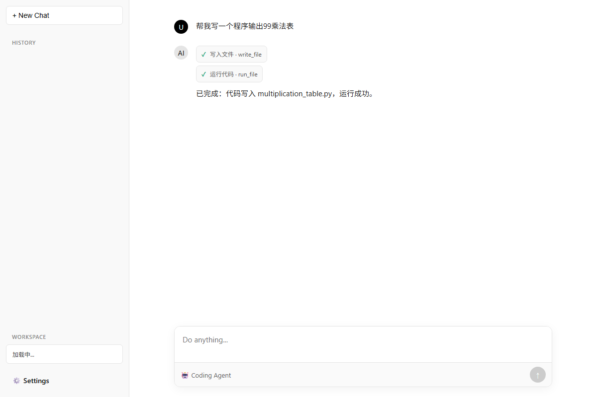
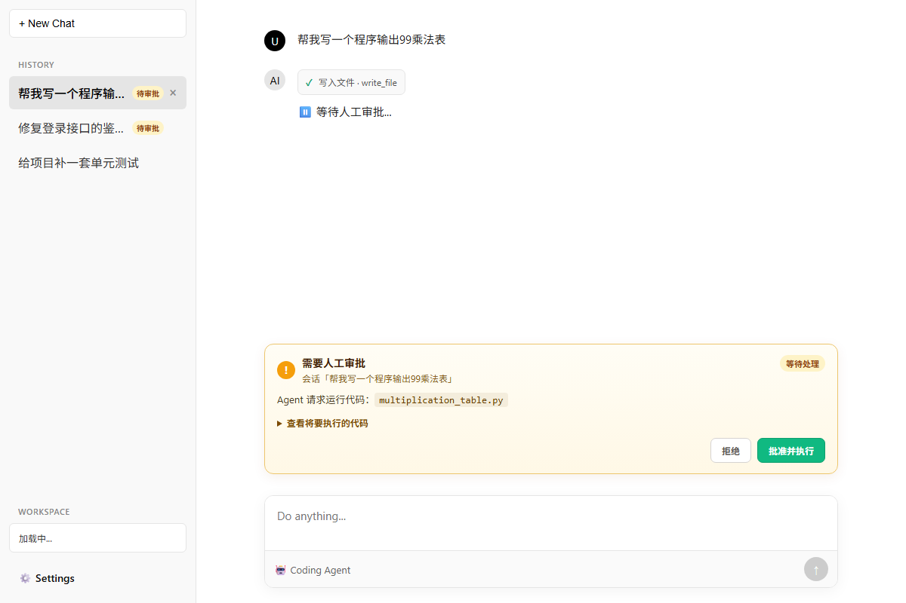
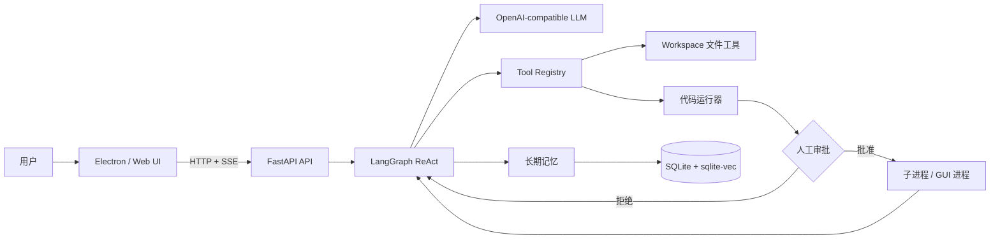

# Coding Agent

一个面向本地开发场景的 AI 编程助手。用户用自然语言描述需求，Agent 可以创建和修改代码、运行程序、读取错误并继续迭代，同时通过 Human-in-the-Loop 审批控制危险操作。


> 个人项目，仍在持续迭代。当前桌面版优先支持 Windows。

## 界面预览

<p align="center">
  
  
</p>

左图为工具执行状态与会话列表；右图为不遮挡页面的审批面板和待审批会话标记。

## 功能特性

- **ReAct 编程循环**：Agent 根据工具结果持续规划、修改和验证代码。
- **文件操作**：创建、读取、编辑、列出和搜索 workspace 中的文件。
- **代码执行**：在独立子进程中运行 Python 程序，返回结构化执行结果。
- **GUI 程序支持**：自动识别 Tkinter、PyQt/PySide、wx、Pygame 等窗口程序；窗口成功启动后立即返回，不等待用户关闭。
- **人工审批**：代码执行前暂停图状态，用户批准或拒绝后继续；审批信息按会话隔离。
- **非阻塞审批框**：审批面板位于输入框上方，不覆盖整个界面，不影响切换或管理其他会话。
- **错误分类**：区分程序运行错误、依赖缺失、GUI 环境异常、启动失败和执行超时，减少无效修改。
- **工具调用上限**：默认最多执行 8 轮工具调用，避免 Agent 无限循环。
- **长期记忆**：从对话中提取用户偏好、事实和事件，并通过 SQLite FTS5 + 向量检索召回。
- **会话管理**：支持多会话、历史记录、会话删除和待审批状态提示。
- **桌面应用**：内置 Electron、Python 运行时和后端依赖，可打包成无需预装 Python 的 Windows 便携应用。

## 工作流程



一次典型任务：

1. 用户描述目标。
2. Agent 调用 `write_file` 创建代码。
3. Agent 调用 `run_file` 请求执行。
4. 图在 `interrupt()` 处暂停，前端显示审批框。
5. 用户批准后，代码在 workspace 子进程中运行。
6. Agent 根据结构化结果修复代码或给出简短总结。

## 技术栈

| 层级 | 技术 |
|---|---|
| Agent 编排 | LangGraph |
| LLM | DeepSeek / OpenAI-compatible Chat Completions API |
| Embedding | 阿里云 DashScope |
| API | FastAPI + SSE |
| 数据库 | SQLite、FTS5、sqlite-vec |
| 前端 | 原生 HTML / CSS / JavaScript |
| 桌面端 | Electron |
| 执行环境 | Python 子进程 |

## 快速开始

### 环境要求

- Windows 10/11
- Python 3.12+
- [uv](https://docs.astral.sh/uv/)
- Node.js 18+
- npm

### 1. 获取代码

```bash
git clone <YOUR_REPOSITORY_URL>
cd coding-agent
```

### 2. 安装依赖

```powershell
uv sync
npm install
```

### 3. 启动桌面应用

```powershell
npm start
```

Electron 会自动启动 FastAPI 后端并加载页面。首次启动会创建 `.env` 和 SQLite 数据库，并打开设置窗口。

### 仅启动后端

```powershell
$env:PYTHONPATH = "src"
uv run uvicorn app.api.main:app --host 127.0.0.1 --port 8000
```

访问：

```text
http://127.0.0.1:8000
```

## 配置

开发模式下，配置文件位于项目根目录：

```text
.env
```

首次运行时，程序会根据 `.env` 模板自动创建配置文件。至少需要填写：

```env
LLM_API_KEY=your_llm_api_key
EMBEDDING_API_KEY=your_embedding_api_key
```

常用配置：

| 变量 | 默认值 | 说明 |
|---|---|---|
| `LLM_PROVIDER` | `deepseek` | LLM 提供商标识 |
| `LLM_API_KEY` | 空 | LLM API Key |
| `LLM_BASE_URL` | `https://api.deepseek.com` | Chat Completions API 地址 |
| `LLM_MODEL` | `deepseek-chat` | 主模型 |
| `EMBEDDING_API_KEY` | 空 | DashScope API Key |
| `EMBEDDING_BASE_URL` | `https://dashscope.aliyuncs.com/api/v1` | Embedding API 地址 |
| `EMBEDDING_MODEL` | `text-embedding-v3` | Embedding 模型 |
| `WORKSPACE_PATH` | `workspace` | Agent 文件工作区 |
| `DB_PATH` | `data/coding_agent.db` | SQLite 数据库 |
| `MAX_TOOL_ROUNDS` | `8` | 单次用户请求的最大工具轮数 |
| `SANDBOX_TIMEOUT` | `10` | 普通脚本最长执行时间（秒） |
| `GUI_STARTUP_GRACE` | `2.0` | GUI 启动成功判定时间（秒） |
| `TOOL_OUTPUT_MAX_CHARS` | `6000` | 工具输出最大保留字符数 |

API Key 也可以通过应用内的 Settings 面板修改。

## 内置工具

| 工具 | 作用 |
|---|---|
| `write_file` | 写入完整文件 |
| `read_file` | 读取文件内容 |
| `edit_file` | 按唯一文本片段替换文件内容 |
| `list_files` | 列出 workspace 文件 |
| `grep_content` | 搜索文件内容并返回匹配行 |
| `run_file` | 运行 Python 脚本或 GUI 程序 |
| `analyze_code` | 静态分析 Python 语法、函数和类 |
| `review_code` | 调用 LLM 审查代码 |

`run_file` 支持三种模式：

- `auto`：自动判断是否为 GUI，推荐默认使用。
- `script`：等待脚本退出，超时后终止进程。
- `gui`：窗口存活超过启动判定时间即返回 `gui_started`，不等待窗口关闭。

运行结果使用结构化 JSON 状态：

```json
{
  "status": "gui_started",
  "filename": "app.py",
  "mode": "gui",
  "pid": 1234
}
```

可能的状态包括 `completed`、`gui_started`、`runtime_error`、`dependency_error`、`environment_error`、`timeout`、`launch_error` 和 `rejected`。

## Human-in-the-Loop 审批

`run_file` 执行前会调用 LangGraph `interrupt()`。审批信息包含：

- 会话 ID
- 文件名
- 待执行代码
- 检测到的运行模式

前端通过 `Command(resume=...)` 提交批准或拒绝结果。审批状态在当前后端进程运行期间按会话恢复；后端进程重启后，未完成的图中断不会保留。

## 长期记忆

每轮对话结束后，系统会异步提取值得长期保留的信息：

- `preference`：技术栈、编码偏好和交互偏好。
- `fact`：用户背景和持久事实。
- `event`：近期计划或临时状态。

记忆通过 ADD / UPDATE / SUPERSEDE / NOOP 策略处理冲突，旧记录通常被标记为失效而不是直接删除。

## 打包 Windows 桌面版

项目包含完整的便携版构建脚本：

```powershell
npm run build:desktop
```

输出：

```text
dist/CodingAgent-Windows-x64/
dist/CodingAgent-Windows-x64.zip
```

打包过程会：

1. 复制 Electron 运行时。
2. 放入 Electron 主进程和前端资源。
3. 复制 Python 后端源码。
4. 复制基础 Python、Tcl/Tk 和 `site-packages`。
5. 移除指向开发机路径的 `.pth` 文件。
6. 生成便携目录和 ZIP 压缩包。

桌面版的数据保存在：

```text
%APPDATA%\Coding Agent
```

其中包含 `.env`、数据库、workspace 和日志。API Key、聊天记录和用户代码不会被打进安装包。

构建脚本：[scripts/build-desktop.ps1](scripts/build-desktop.ps1)

## API

| 方法 | 路径 | 说明 |
|---|---|---|
| `GET` | `/api/health` | 后端健康检查 |
| `POST` | `/api/chat` | 发起对话并返回 SSE 流 |
| `POST` | `/api/approve` | 批准或拒绝代码执行 |
| `GET` | `/api/sessions` | 获取会话列表 |
| `POST` | `/api/sessions` | 创建会话 |
| `GET` | `/api/sessions/{id}/messages` | 获取历史消息 |
| `GET` | `/api/sessions/{id}/approval` | 查询待审批状态 |
| `DELETE` | `/api/sessions/{id}` | 删除会话及关联数据 |

SSE 事件类型包括 `text`、`tool_end`、`interrupt`、`limit`、`error` 和 `done`。

## 项目结构

```text
.
├── electron/
│   ├── main.js                 Electron 主进程
│   └── preload.js              受控 IPC 接口
├── src/app/
│   ├── api/                    FastAPI、SSE、设置和前端页面
│   ├── db/                     SQLite 连接与 schema
│   ├── graph/                  LangGraph 节点、路由和状态
│   ├── llm/                    LLM、Embedding 和调用记录
│   ├── memory/                 长期记忆提取、检索和冲突消解
│   └── tools/                  文件、运行器和工具注册表
├── scripts/build-desktop.ps1   Windows 便携版构建脚本
├── packaging/                  桌面版说明与快捷方式脚本
└── tests/                      手动集成检查脚本
```

## 安全说明

- 代码执行前需要人工批准。
- 子进程执行只是基础隔离，不等同于安全沙箱。
- 不要在不可信代码或敏感数据环境中把审批机制当作完整安全边界。
- 如需运行不可信代码，建议进一步接入容器、虚拟机或受限系统账户。
- API Key 只应保存在本地 `.env` 或桌面版用户数据目录，不要提交到 Git。

## 已知限制

- 当前桌面构建主要面向 Windows，尚未提供签名安装器。
- LangGraph 使用 `MemorySaver`，未完成的审批状态不会跨后端进程持久化。
- 代码执行使用本地子进程，不是生产级安全沙箱。
- 目前没有自动化 CI 测试矩阵。
- 桌面版暂未配置代码签名，Windows SmartScreen 可能显示“未知发布者”。

## Roadmap

- 增加自动化测试与 GitHub Actions CI。
- 使用持久化 checkpointer 保存审批状态。
- 增加 Docker/容器执行后端。
- 增加 Token 用量和成本展示。
- 提供签名安装器和自动更新。
- 支持更多模型提供商与本地模型。

## Contributing

欢迎提交 Issue 和 Pull Request。提交前请：

1. 不要提交 `.env`、数据库、日志或用户 API Key。
2. 说明复现步骤和预期行为。
3. 保持修改范围清晰，并附上验证方式。

## License

ISC License.
