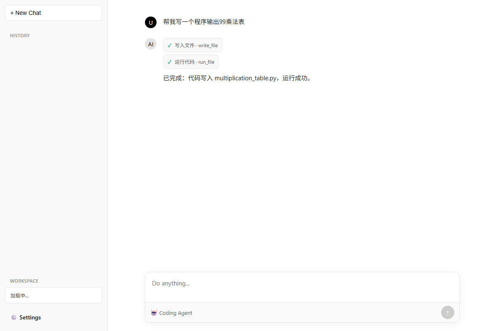
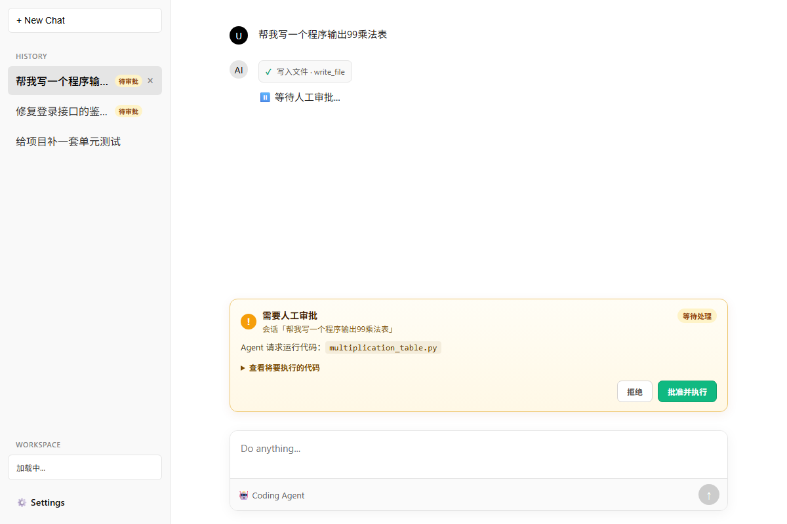
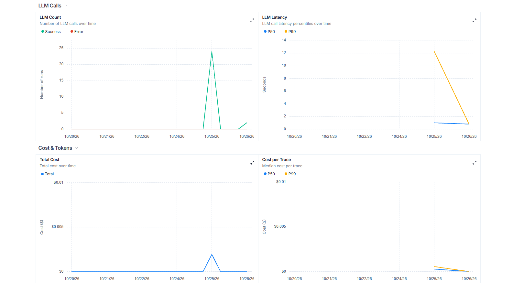
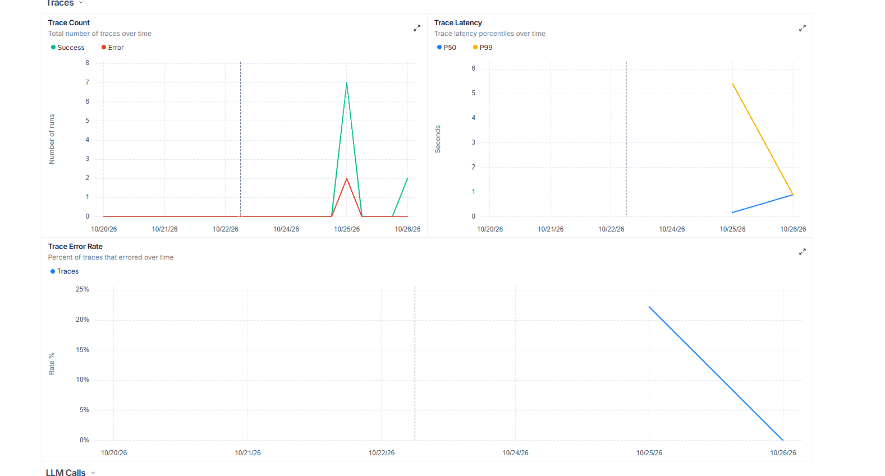
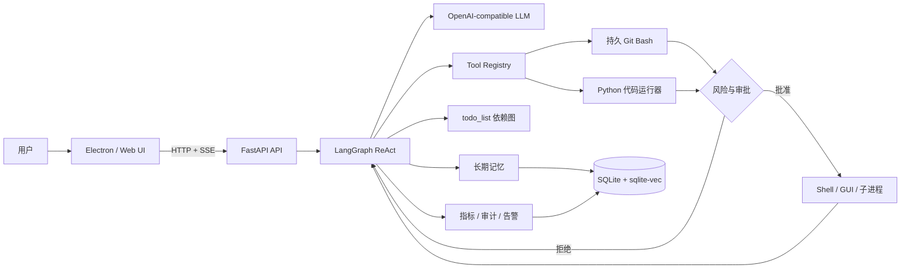

# Coding Agent

一个面向本地开发者的可治理 Coding Agent 桌面应用。用户用自然语言描述需求，Agent 通过 todo 依赖图规划任务、持久 Git Bash 批量读写代码、运行测试并继续迭代，同时对高风险命令执行能力鉴权、人工审批、重试、熔断、审计和成本控制。


> 个人项目，仍在持续迭代。当前桌面版优先支持 Windows。

## 版本信息

**当前版本：v1.2.0 — Guarded Runtime（可治理运行时）**
发布日期：2026-11-10
发布分支：`codex/release-v1.2.0-guarded-runtime`
Git 标签：`v1.2.0`

Guarded Runtime 聚焦于把 Coding Agent 从“能执行工具的原型”升级为有任务计划、有权限边界、有故障恢复、有成本上限并能生成量化评测证据的本地运行时。

### v1.1.0 → v1.2.0

| 能力 | v1.1.0 | v1.2.0 Guarded Runtime |
|---|---|---|
| 任务规划 | 隐式 ReAct 循环 | `todo_write` 依赖图、拓扑波次和状态更新 |
| 文件修改 | 多个结构化写工具 | 持久 Git Bash，一次调用完成多步脚本 |
| 并行 | 工具顺序执行 | 无依赖 todo 可标记 `parallel=true` 并行 |
| 安全 | `run_file` 前审批 | Bash 风险分级、操作哈希审批、提权阻断和审计 |
| 容错 | LLM 重试与熔断 | LLM/工具分类重试、循环指纹和会话恢复 |
| 运行治理 | 无全局并发限制 | 全局任务配额、会话互斥、Shell 空闲回收 |
| 成本 | 事后 Token 统计 | 会话 Token/日成本预算、80% 降级和 100% 安全停止 |
| 可观测性 | 可选 LangSmith | 本地任务/工具/审批/告警表、`/api/metrics` 和 JSONL 事件 |
| 发布 | 固定版本 | 会话哈希灰度、指标回滚门槛和模型回退链 |
| 验证 | 手工集成脚本 | 自动化回归测试 + 两轮故障注入指标报告 |

### v1.2.0 主要更新

- 移除 Agent 可调用的 `write_file`、`write_files`、`edit_file` 和 `apply_edit_batch`，统一通过 `bash_exec` 修改代码。
- 新增持久 Git Bash 会话、输出协议、超时清理、脱敏环境和 workspace cwd 校验。
- 新增 todo 依赖验证、拓扑波次、`todo_id` 依赖门禁和并行安全调用。
- 新增 `rm`、Git 破坏性命令、代码执行、网络访问和 workspace 外路径的风险审批。
- 新增重复工具指纹、最大轮次、全局并发、会话互斥、Token/成本预算、模型降级和灰度回滚。
- 新增 `evals/report.md`：60 个任务、每组 3 次、共两轮 360 次运行的指标对比。

## 界面预览

<p align="center">
  
  
</p>

左图为工具执行状态与会话列表；右图为不遮挡页面的审批面板和待审批会话标记。

## LangSmith 可观测性

项目可以按会话记录 LangGraph 节点、流式 LLM 调用、工具执行、Token 用量和成本。以下截图来自 `coding-agent` 项目的实际测试 Trace。



上图展示 LLM 调用次数、P50/P99 延迟、Total Cost 和 Cost per Trace。



上图展示 Trace 数量、成功/错误分布、P50/P99 延迟和错误率。

> 人工审批触发 LangGraph interrupt 时，当前 Trace 可能被 LangSmith 标记为 `error`，这属于预期的工作流中断，不一定是代码执行失败。应结合 `tools` 调用树和审批状态共同判断。

## 功能特性

- **计划式 ReAct 编程循环**：Agent 先用 `todo_write` 建立依赖图，再根据工具结果推进和更新任务。
- **持久 Git Bash**：同一会话保留 cwd 和环境，一次调用可完成写入、搜索、测试和修复，减少重复工具往返。
- **依赖感知并行**：依赖完成的独立 todo 可通过 `parallel=true` 使用隔离 Shell 并发执行。
- **代码执行**：在独立子进程中运行 Python、测试和 Bash 命令，返回结构化状态、退出码和输出。
- **Token 流式输出**：主 Agent 接入 OpenAI-compatible 流式接口，并将增量文本通过 SSE 实时推送到前端。
- **重试与熔断**：LLM 对网络失败、429 和 5xx 重试；幂等工具分类重试；模型按名称独立熔断并支持回退链。
- **LangSmith 可观测性**：可选记录 LangGraph 图、LLM 调用和工具执行，查看耗时、Token 和嵌套调用链。
- **GUI 程序支持**：自动识别 Tkinter、PyQt/PySide、wx、Pygame 等窗口程序；窗口成功启动后立即返回，不等待用户关闭。
- **人工审批**：危险 Bash、代码执行和 `run_file` 前暂停图状态，用户批准或拒绝后继续；审批绑定命令和 cwd 哈希。
- **非阻塞审批框**：审批面板位于输入框上方，不覆盖整个界面，不影响切换或管理其他会话。
- **错误分类**：区分程序运行错误、依赖缺失、GUI 环境异常、启动失败和执行超时，减少无效修改。
- **工具调用上限**：默认最多执行 12 轮工具调用；相同调用指纹达到阈值后立即阻断。
- **运行治理**：全局并发任务数、单会话互斥、Bash 会话上限、空闲回收和进程树清理。
- **成本治理**：会话 Token 和每日成本预算；达到 80% 切换降级模型，达到上限安全停止。
- **结构化可观测性**：本地记录任务、工具、审批、审计和告警，暴露 `/api/metrics`。
- **灰度与回滚**：按会话哈希进行稳定版本/灰度版本分配；成功率、崩溃率和循环率恶化时自动回退。
- **长期记忆**：从对话中提取用户偏好、事实和事件，并通过 SQLite FTS5 + 向量检索召回。
- **会话管理**：支持多会话、历史记录、会话删除和待审批状态提示。
- **惰性会话创建**：空白新对话不落库，首次发送消息时才创建会话；首次请求失败会自动回滚空会话。
- **桌面应用**：内置 Electron、Python 运行时和后端依赖，可打包成无需预装 Python 的 Windows 便携应用。

## 工作流程



一次典型任务：

1. 用户描述目标。
2. Agent 调用 `todo_write`，声明步骤、依赖和可并行项。
3. Agent 使用 `bash_exec` 在一次持久 Shell 脚本中写入代码、测试和进行验证。
4. 非只读命令触发风险判断；高风险操作在 `interrupt()` 处暂停并显示审批框。
5. 独立且依赖已满足的 todo 可使用 `parallel=true` 并行执行。
6. Agent 根据结构化结果修复代码、更新 todo 并给出简短总结。

## 技术栈

| 层级 | 技术 |
|---|---|
| Agent 编排 | LangGraph |
| LLM | DeepSeek / OpenAI-compatible Chat Completions API |
| Embedding | 阿里云 DashScope |
| API | FastAPI + SSE |
| 数据库 | SQLite、FTS5、sqlite-vec |
| 前端 | 原生 HTML / CSS / JavaScript |
| 桌面端 | Electron |
| 执行环境 | Git Bash + Python 子进程 |

## 快速开始

### 环境要求

- Windows 10/11
- Git for Windows（开发模式需在 `PATH` 中能找到 `bash.exe`；桌面版会内置）
- Python 3.12+
- [uv](https://docs.astral.sh/uv/)
- Node.js 18+
- npm

### 1. 获取代码

```bash
git clone https://github.com/wenbralliance/Coding-agent-human-in-the-loop.git
cd Coding-agent-human-in-the-loop
```

### 2. 安装依赖

```powershell
uv sync
npm install
```

### 3. 启动桌面应用

```powershell
npm start
```

Electron 会自动启动 FastAPI 后端并加载页面。首次启动会创建 `.env` 和 SQLite 数据库，并打开设置窗口。

### 仅启动后端

```powershell
$env:PYTHONPATH = "src"
uv run uvicorn app.api.main:app --host 127.0.0.1 --port 8000
```

访问：

```text
http://127.0.0.1:8000
```

## 配置

开发模式下，配置文件位于项目根目录：

```text
.env
```

首次运行时，程序会根据 `.env` 模板自动创建配置文件。至少需要填写：

```env
LLM_API_KEY=your_llm_api_key
EMBEDDING_API_KEY=your_embedding_api_key
```

常用配置：

| 变量 | 默认值 | 说明 |
|---|---|---|
| `LLM_PROVIDER` | `deepseek` | LLM 提供商标识 |
| `LLM_API_KEY` | 空 | LLM API Key |
| `LLM_BASE_URL` | `https://api.deepseek.com` | Chat Completions API 地址 |
| `LLM_MODEL` | `deepseek-chat` | 主模型 |
| `LLM_FALLBACK_MODEL` | 空 | 熔断或预算阈值触发的降级模型 |
| `LLM_SESSION_TOKEN_BUDGET` | `200000` | 单会话 24 小时 Token 预算 |
| `LLM_DAILY_COST_BUDGET_USD` | `5.0` | 全球每日成本预算 |
| `LLM_BUDGET_DEGRADE_RATIO` | `0.8` | 达到预算比例后切换降级模型 |
| `LLM_INPUT_COST_PER_MILLION` | `0` | 每百万输入 Token 的成本（USD） |
| `LLM_OUTPUT_COST_PER_MILLION` | `0` | 每百万输出 Token 的成本（USD） |
| `LLM_CACHED_INPUT_COST_PER_MILLION` | `0` | 每百万缓存命中输入 Token 的成本（USD） |
| `LANGSMITH_TRACING` | `false` | 是否启用 LangSmith 追踪 |
| `LANGSMITH_API_KEY` | 空 | LangSmith API Key |
| `LANGSMITH_PROJECT` | `coding-agent` | LangSmith 项目名 |
| `EMBEDDING_API_KEY` | 空 | DashScope API Key |
| `EMBEDDING_BASE_URL` | `https://dashscope.aliyuncs.com/api/v1` | Embedding API 地址 |
| `EMBEDDING_MODEL` | `text-embedding-v3` | Embedding 模型 |
| `WORKSPACE_PATH` | `workspace` | Agent 文件工作区 |
| `DB_PATH` | `data/coding_agent.db` | SQLite 数据库 |
| `BASH_EXECUTABLE` | 空 | Git Bash 路径；留空自动检测或使用桌面版内置路径 |
| `BASH_TIMEOUT` | `60` | 单次 Bash 调用最大秒数 |
| `BASH_OUTPUT_MAX_BYTES` | `32000` | 每次 stdout/stderr 保留字节数 |
| `BASH_SESSION_IDLE_SECONDS` | `600` | 持久 Shell 空闲回收时间 |
| `MAX_BASH_SESSIONS` | `4` | 同时保留的持久 Shell 数 |
| `MAX_PARALLEL_TOOLS` | `4` | 一组并行工具调用的最大并发数 |
| `MAX_CONCURRENT_TASKS` | `2` | 全局并行 Agent 任务数 |
| `MAX_TOOL_ROUNDS` | `12` | 单次用户请求的最大工具轮数 |
| `LOOP_REPEAT_THRESHOLD` | `3` | 相同工具调用达到多少次后阻断 |
| `MAX_READ_FILES` | `50` | 单次批量读取最大文件数 |
| `MAX_READ_CHARS_PER_CALL` | `100000` | 单次批量读取最大字符数 |
| `SANDBOX_TIMEOUT` | `10` | 普通脚本最长执行时间（秒） |
| `GUI_STARTUP_GRACE` | `2.0` | GUI 启动成功判定时间（秒） |
| `TOOL_OUTPUT_MAX_CHARS` | `6000` | 工具输出最大保留字符数 |
| `CIRCUIT_BREAKER_THRESHOLD` | `5` | 连续临时失败多少次后开启熔断 |
| `CIRCUIT_BREAKER_COOLDOWN` | `60` | 熔断冷却时间（秒） |
| `WORKFLOW_VERSION` | `v1.2.0-guarded` | 稳定工作流版本 |
| `CANARY_VERSION` | 空 | 灰度版本标签，留空关闭 |
| `CANARY_PERCENT` | `0` | 按会话哈希分配的灰度比例 |

LLM、Embedding 和 LangSmith 配置也可以通过应用内的 Settings 面板修改。

启用 LangSmith 追踪：

```env
LANGSMITH_TRACING=true
LANGSMITH_API_KEY=your_langsmith_api_key
LANGSMITH_PROJECT=coding-agent
```

启用后可以在 LangSmith 中查看 Graph 节点、LLM 流式调用、工具执行、耗时与 Token 使用情况。
把模型服务的每百万 Token 单价填入上述成本配置后，LangSmith 的项目统计和单条 Trace 还会显示 Prompt、Completion 和 Total Cost。

## 内置工具

| 工具 | 作用 |
|---|---|
| `todo_write` | 创建或更新任务依赖图，返回拓扑执行波次 |
| `todo_read` | 读取当前会话任务计划 |
| `bash_exec` | 在持久 Git Bash 中执行批量脚本和代码修改 |
| `bash_reset` | 关闭当前会话的持久 Shell |
| `read_file` | 读取文件内容 |
| `read_files` | 一次读取多个文件及 SHA256 |
| `list_files` | 列出 workspace 文件 |
| `grep_content` | 搜索文件内容并返回匹配行 |
| `run_file` | 运行 Python 脚本或 GUI 程序 |
| `analyze_code` | 静态分析 Python 语法、函数和类 |
| `review_code` | 调用 LLM 审查代码 |

`run_file` 支持三种模式：

- `auto`：自动判断是否为 GUI，推荐默认使用。
- `script`：等待脚本退出，超时后终止进程。
- `gui`：窗口存活超过启动判定时间即返回 `gui_started`，不等待窗口关闭。

运行结果使用结构化 JSON 状态：

```json
{
  "status": "gui_started",
  "filename": "app.py",
  "mode": "gui",
  "pid": 1234
}
```

可能的状态包括 `completed`、`gui_started`、`runtime_error`、`dependency_error`、`environment_error`、`timeout`、`launch_error` 和 `rejected`。

## Human-in-the-Loop 审批

Bash 和 `run_file` 在命中风险策略后调用 LangGraph `interrupt()`。Bash 审批信息包含：

- 完整命令和 cwd
- 风险等级与命中的规则
- 绑定命令、cwd 和 workspace 的操作哈希
- 审批有效期和会话隔离信息

`rm`、`rmdir`、`find -delete`、`git clean/reset --hard`、解释器/测试执行、网络访问和 workspace 外路径会进入审批；管理员提权命令直接拒绝。前端通过 `Command(resume=...)` 提交批准或拒绝结果。

审批状态在当前后端进程运行期间按会话恢复；审批和审计事件会持久化到 SQLite，但后端重启后未完成的 LangGraph 中断仍不会自动恢复。

## 长期记忆

每轮对话结束后，系统会异步提取值得长期保留的信息：

- `preference`：技术栈、编码偏好和交互偏好。
- `fact`：用户背景和持久事实。
- `event`：近期计划或临时状态。

记忆通过 ADD / UPDATE / SUPERSEDE / NOOP 策略处理冲突，旧记录通常被标记为失效而不是直接删除。

## 打包 Windows 桌面版

项目包含完整的便携版构建脚本：

```powershell
npm run build:desktop
```

输出：

```text
dist/CodingAgent-Windows-x64/
dist/CodingAgent-Windows-x64.zip
```

打包过程会：

1. 复制 Electron 运行时。
2. 放入 Electron 主进程和前端资源。
3. 复制 Python 后端源码。
4. 复制基础 Python、Tcl/Tk 和 `site-packages`。
5. 复制自包含 Git Bash 运行时，并注入 `CODING_AGENT_BASH_EXECUTABLE`。
6. 移除指向开发机路径的 `.pth` 文件。
7. 生成便携目录和 ZIP 压缩包。

桌面版的数据保存在：

```text
%APPDATA%\Coding Agent
```

其中包含 `.env`、数据库、workspace 和日志。API Key、聊天记录和用户代码不会被打进安装包。

构建脚本：[scripts/build-desktop.ps1](scripts/build-desktop.ps1)

## API

| 方法 | 路径 | 说明 |
|---|---|---|
| `GET` | `/api/health` | 后端健康检查 |
| `POST` | `/api/chat` | 发起对话并返回 SSE 流 |
| `POST` | `/api/approve` | 批准或拒绝代码执行 |
| `GET` | `/api/sessions` | 获取会话列表 |
| `POST` | `/api/sessions` | 创建会话 |
| `GET` | `/api/sessions/{id}/messages` | 获取历史消息 |
| `GET` | `/api/sessions/{id}/approval` | 查询待审批状态 |
| `GET` | `/api/metrics` | 获取本地任务、工具和告警聚合指标 |
| `POST` | `/api/tasks/{id}/cancel` | 停止 Shell/进程并清理当前图检查点 |
| `POST` | `/api/bash/{id}/reset` | 关闭会话的持久 Git Bash |
| `DELETE` | `/api/sessions/{id}` | 删除会话及关联数据 |

SSE 事件类型包括 `text`、`tool_end`、`interrupt`、`limit`、`error` 和 `done`。

## 项目结构

```text
.
├── electron/
│   ├── main.js                 Electron 主进程
│   └── preload.js              受控 IPC 接口
├── src/app/
│   ├── api/                    FastAPI、SSE、设置和前端页面
│   ├── db/                     SQLite 连接与 schema
│   ├── graph/                  LangGraph、todo 依赖图和循环保护
│   ├── llm/                    LLM、预算、降级、熔断和调用记录
│   ├── memory/                 长期记忆提取、检索和冲突消解
│   ├── runtime/                全局并发和会话容量管理
│   ├── security.py             Bash 风险分级与审批哈希
│   ├── observability.py        指标、审计、告警和事件日志
│   └── tools/                  Git Bash、todo、文件读取和运行器
├── evals/
│   ├── benchmark.py            两轮故障注入基准
│   ├── benchmark_report.json   原始指标与 360 条运行明细
│   └── report.md               可直接阅读的指标报告
├── scripts/build-desktop.ps1   Windows 便携版构建脚本
├── packaging/                  桌面版说明与快捷方式脚本
└── tests/                      自动化回归测试与历史集成脚本
```

## 自动化测试与指标

运行自动化回归测试：

```powershell
npm test
```

重新生成两轮指标报告：

```powershell
npm run benchmark
```

完整结果见 [evals/report.md](evals/report.md)。当前报告基于 60 个固定任务、每组重复 3 次，共执行两轮 360 次确定性故障注入流程，不调用真实 LLM，也不代表线上生产流量。核心对比：

| 指标 | v1.1 baseline | v1.2 guarded |
|---|---:|---:|
| 任务成功率 | 51.7% | 85.0% |
| 工具失败导致崩溃率 | 41.7% | 0.0% |
| 未受控死循环占比 | 16.7% | 0.0% |
| 瞬时故障恢复率 | 0.0% | 100.0% |
| 高风险操作拦截率 | 0.0% | 100.0% |

## 安全说明

- Bash 风险检查是策略层防护，不等同于操作系统安全沙箱。
- 删除、Git 破坏性操作、代码执行、网络和非零风险命令需要审批；提权命令默认拒绝。
- 子进程执行提供 cwd、环境变量白名单、超时、输出和进程树限制，但 Git Bash 仍继承当前 Windows 用户权限。
- 不要在不可信代码或敏感数据环境中把审批机制当作完整安全边界。
- 如需运行不可信代码，建议进一步接入容器、虚拟机或受限系统账户。
- API Key 只应保存在本地 `.env` 或桌面版用户数据目录，不要提交到 Git。

## 已知限制

- 当前桌面构建主要面向 Windows，尚未提供签名安装器。
- LangGraph 使用 `MemorySaver`，未完成的审批状态不会跨后端进程持久化。
- Git Bash 使用当前 Windows 用户权限，不是生产级安全沙箱。
- 两轮指标来自离线故障注入基准，不是线上 LLM 生产流量。
- 已有自动化回归脚本，但尚未配置 GitHub Actions CI 矩阵。
- 桌面版暂未配置代码签名，Windows SmartScreen 可能显示“未知发布者”。

## Roadmap

- 增加自动化测试与 GitHub Actions CI。
- 使用持久化 checkpointer 保存审批状态。
- 提供签名安装器和自动更新。
- 支持更多模型提供商与本地模型。

## Contributing

欢迎提交 Issue 和 Pull Request。提交前请：

1. 不要提交 `.env`、数据库、日志或用户 API Key。
2. 说明复现步骤和预期行为。
3. 保持修改范围清晰，并附上验证方式。

## License

ISC License.
